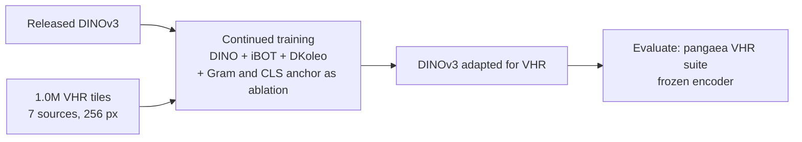

# DINOv3-VHR

Continual self-supervised training of DINOv3 for very high resolution (VHR) overhead imagery.

## Intro

This project continues pre-training of the released DINOv3 encoder on VHR aerial and satellite
images so it works better for overhead imagery. The goal is a VHR specific foundation model
built on DINOv3.

DINOv3 is released in several sizes. The ViT-Large (LVD) model is the intended base for the
final VHR model. Early experiments use the smaller ViT-S model to check that the method works
before moving to the larger model. Downstream numbers are reported with the encoder frozen and
only a task head trained on top, so the score reflects the quality of the frozen features.

## Methodology



## Pre-training images

The training images are 1,018,163 unlabeled 256 x 256 RGB tiles from seven open sources (fMoW,
Maxar Open Data, OpenAerialMap, NAIP, RAMP, WorldStrat, Planet), published as WebDataset shards
at [kshitijrajsharma/dinov3-vhr-pretrain](https://huggingface.co/datasets/kshitijrajsharma/dinov3-vhr-pretrain),
with an [interactive coverage map](https://huggingface.co/spaces/kshitijrajsharma/dinov3-vhr-coverage).
An equal-weight mix draws each source with the same probability, so every sensor is seen in a
roughly one-seventh share. Images overlapping the evaluation suite are held out at build time.
See [pretraining_datasets.md](pretraining_datasets.md) for the full breakdown, licenses, and holdouts.

## Training

There is one model being trained, the student. It learns from two teachers that produce no
gradients: an exponential moving average (EMA) of the student, and an anchor teacher that
provides a preservation reference.

The EMA teacher is not trained directly. After each step its weights are set to a slow running
average of the student (`teacher = m * teacher + (1 - m) * student`, with `m` close to 1). It
changes gradually, giving the student a stable target and keeping training from collapsing.

The anchor teacher provides the reference for the preservation losses. By default it is
periodically re-snapshotted from the EMA teacher, so it tracks the VHR adaptation rather than
pinning the student to the original natural-image structure. It can also be held fixed at the
released model (`--anchor-target frozen`) for comparison.

| objective | student input | teacher | target |
| --- | --- | --- | --- |
| DINO | full crops (global and local) | EMA | class-token output on the global crops |
| iBOT | global crops with patches masked | EMA | patch outputs on the same crops, unmasked |
| DKoleo | global crops | none | spreads class-token embeddings apart in the batch |
| Gram anchor | global crops | anchor | patch-to-patch similarity structure |
| CLS anchor | global crops | anchor | class-token embedding direction |

The total loss:

```
loss = DINO + 2.0 * Gram + 1.0 * iBOT + 0.1 * DKoleo + w_cls * CLS_anchor
```

The reported model is the anchor-free control, which sets the Gram and CLS anchor weights to
zero, so its loss reduces to `DINO + 1.0 * iBOT + 0.1 * DKoleo`.

DINO and iBOT use the [lightly](https://github.com/lightly-ai/lightly) library. The Gram loss
follows the DINOv3 formula. The CLS anchor is a cosine distillation of the class token to the
anchor teacher, in the spirit of feature-distillation continual learning (CaSSLe).

Because the released checkpoints carry backbone weights only, the DINO and iBOT projection
heads start from random init. Training runs in two stages: the heads first converge against a
frozen backbone, then the backbone unfreezes behind a linear learning-rate ramp, which prevents
the random heads from destabilising the pretrained weights.

### Differences with the DINOv3 paper

- It continues training the released DINOv3 instead of training a new model from scratch.
- It adds a CLS anchor to preserve the class token, alongside the Gram anchor for patches.
- The anchor teacher defaults to a refreshed self-snapshot. The DINOv3 Gram teacher is an early
  copy from the same run; a fixed frozen-released target is available as an option.
- All objectives run together after the head warm-up. The paper adds Gram as a separate later
  stage and also has a high resolution stage, which is not used here.

### Tokens

A ViT cuts each image into a grid of patches (a 256 px tile at patch size 16 gives a 16 x 16
grid, so 256 patches). Each patch becomes a vector, the patch tokens, which keep the spatial
layout and describe local regions. One extra vector is added, the class token, a summary of the
whole image. DINO and the CLS anchor shape the class token; iBOT and the Gram anchor shape the
patch tokens.

### iBOT

iBOT teaches patch level features by filling in hidden patches, like masked word prediction in
language models. About 30 percent of each global crop's patches are replaced with a mask token;
the student predicts, for those positions, what the EMA teacher produces from the full unmasked
crop. The loss is the cross entropy between the student and teacher distributions at the masked
positions.

### Gram anchoring

Gram anchoring keeps the dense patch features structured while the model adapts to VHR images.
Instead of holding feature values fixed, it holds the pattern of similarities between patches.
For patch features `X` (normalized per patch), the similarity matrix is `X X^T`, and the loss is
the mean squared error between the student and teacher matrices on the global crops:

```
L_gram = MSE( sim(student patches), sim(anchor patches) )
```

The features can move and adapt as long as the structure of patch relationships stays close to
the anchor teacher.

## Evaluation

Evaluation uses the pangaea2.0 VHR suite with the encoder frozen and a task decoder trained per
dataset, spanning segmentation, classification, regression, and detection. Reported against the
frozen DINOv3-LVD and DINOv3-SAT baselines on the same protocol.

## Results

The ViT-S runs are an early proof of concept for the method. The reported model is the
continued ViT-L, evaluated under the frozen-encoder protocol described above.

## Limitations

The DINOv3 paper trains a ViT-7B from scratch, and the released ViT-S and ViT-Large models are
distilled from it. This project continues training a distilled model directly, which is not how
the distilled models were produced, so they may respond to continued self-supervised training
differently from a model trained from scratch. Results should be read with that in mind.

## Run

The project uses `uv` and `just`.

### Use the published checkpoint

The reported model (anchor-free control, uniform LR 5e-5, seed 42, ~2k steps) is published at
[kshitijrajsharma/dinov3](https://huggingface.co/kshitijrajsharma/dinov3) as
`vitl_control_lr5e5_s42_step2k.pth`. Download it and evaluate under the frozen-encoder suite
(`--name` only labels the results table, so any name works):

```bash
just setup
uv run hf download kshitijrajsharma/dinov3 vitl_control_lr5e5_s42_step2k.pth --local-dir checkpoints
uv run --group eval python -m dinov3_vhr.eval.run_suite \
  --checkpoint checkpoints/vitl_control_lr5e5_s42_step2k.pth --name vitl_gram0
```

### Reproduce the pretraining

```bash
just setup

# 1. Stage the pretraining corpus: download the tile shards from HF and build the probe sets
sbatch slurm/stage_data.sbatch

# 2. Continual pretraining of the reported ViT-L model: the anchor-free control (gram0) at
#    uniform layer-wise LR (layer_decay 1.0, the launcher default), three seeds. Each run
#    writes out/vitl_gram0_s<seed>_epoch1.pth, the ~2k-step end-of-pass checkpoint.
sbatch slurm/train_vitl.sbatch gram0 42
sbatch slurm/train_vitl.sbatch gram0 1234
sbatch slurm/train_vitl.sbatch gram0 2025

# 3. Evaluate a checkpoint on the pangaea VHR benchmark suite
uv run --group eval python -m dinov3_vhr.eval.run_suite \
  --checkpoint out/vitl_gram0_s42_epoch1.pth --name vitl_gram0
```

The `train_vitl.sbatch` header lists the other arms (`gram2f`, `gram2r`, `full`); pass a third
argument to vary the layer-wise decay, for example `sbatch slurm/train_vitl.sbatch gram0 42 0.9`.

## References

- DINOv3. Siméoni et al., 2025. arXiv:2508.10104. <https://arxiv.org/abs/2508.10104>
- DINOv3 reference code. <https://github.com/facebookresearch/dinov3>
- DINOv2. Oquab et al., 2023. arXiv:2304.07193. <https://arxiv.org/abs/2304.07193>
- DINO. Caron et al., 2021. arXiv:2104.14294. <https://arxiv.org/abs/2104.14294>
- iBOT. Zhou et al., 2021. arXiv:2111.07832. <https://arxiv.org/abs/2111.07832>
- CaSSLe: Self-Supervised Models are Continual Learners. Fini et al., 2022. arXiv:2112.04215. <https://arxiv.org/abs/2112.04215>
- GFM: Towards Geospatial Foundation Models via Continual Pretraining. Mendieta et al., 2023. arXiv:2302.04476. <https://arxiv.org/abs/2302.04476>
- ExPLoRA: Parameter-Efficient Extended Pre-Training to Adapt Vision Transformers under Domain Shifts. Khanna et al., 2024. arXiv:2406.10973. <https://arxiv.org/abs/2406.10973>
- FINO: Who Needs Labels? Adapting Vision Foundation Models With the Metadata You Already Have. Gardès et al., 2026. arXiv:2606.05107. <https://arxiv.org/abs/2606.05107>
- lightly. <https://github.com/lightly-ai/lightly>
- timm. <https://github.com/huggingface/pytorch-image-models>

## License

Copyright 2026 Kshitij Raj Sharma.

The code in this repository is licensed under the Apache License 2.0; see [LICENSE](LICENSE).

The released checkpoint is a derivative of DINOv3 and follows Meta's DINOv3 License
(<https://ai.meta.com/resources/models-and-libraries/dinov3-license/>). The pretraining corpus
is licensed CC-BY-NC-SA-4.0, and each evaluation dataset keeps the license of its original
source. These terms govern the weights and data regardless of the code license above.
